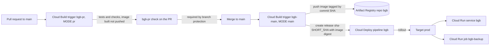

# CI/CD setup

Draft for review. Operator guide for the bgb deployment pipeline: Cloud Build builds and releases, Cloud Deploy rolls out to Cloud Run, Terraform owns the infrastructure around them.

Nothing in this guide has been run against a real project by the author. Anything that depends on GCP or GitHub behaviour is marked as unverified, and the Assumptions section lists what to confirm on the first run. The rollback has not been tested. The cutover has not happened.

Placeholders: `PROJECT` is the GCP project id (`aviato-prod-demo-baby-got-back`), `REGION` is the Terraform `region` (default `australia-southeast1`).

No service account has a key. Each role is granted at the narrowest scope the role supports. Cloud Deploy, logging and quota roles can only be granted on the project.

## Architecture



- Tests run once, on the pull request. A merge to `main` does not retest, so branch protection requires the `bgb-pr` check and an up to date branch.
- The image is built once on the main path and referenced by `@sha256:` digest from then on. No `latest` tag is used anywhere.
- Cloud Deploy owns the running image and the Cloud Run runtime configuration. Terraform owns the surrounding infrastructure and ignores the service and job templates after creating them (decision DEP-D1 below).
- One target exists today: `prod`, with `requireApproval` false.

## Triggers

| Trigger | Event | Branch | `_MODE` | Build file | Runs as |
| --- | --- | --- | --- | --- | --- |
| bgb-pr | Pull request | `^main$` | pr | cloudbuild.yaml | bgb-cloudbuild |
| bgb-main | Push | `^main$` | main | cloudbuild.yaml | bgb-cloudbuild |

`bgb-pr` uses `COMMENTS_ENABLED_FOR_EXTERNAL_CONTRIBUTORS_ONLY`. Owners and collaborators build without a comment. For anyone else, including Dependabot, a maintainer reviews the code and comments `/gcbrun` before the build runs with project credentials. Until that comment, the required `bgb-pr` check stays pending and the PR cannot merge.

The PR build runs the `cloudbuild.yaml` from the PR branch as `bgb-cloudbuild`, so anyone allowed to run it can change what it does. Keep the list of repository collaborators short.

## Service accounts and roles

| Account | Role | Scope | Reason |
| --- | --- | --- | --- |
| bgb-cloudbuild | roles/logging.logWriter | Project | Write build logs (builds use CLOUD_LOGGING_ONLY). |
| bgb-cloudbuild | roles/clouddeploy.releaser | Project | Create Cloud Deploy releases from the main build. |
| bgb-cloudbuild | roles/artifactregistry.writer | Repository bgb | Push images. No access to other repositories. |
| bgb-cloudbuild | roles/iam.serviceAccountUser | Service account bgb-deployer | Creating a release makes Cloud Deploy run as the deployer. |
| bgb-deployer | roles/clouddeploy.jobRunner | Project | Execute Cloud Deploy render and deploy jobs. |
| bgb-deployer | roles/run.developer | Service bgb | Update the service revision. |
| bgb-deployer | roles/run.developer | Job bgb-backup | Update the backup job. |
| bgb-deployer | roles/artifactregistry.reader | Repository bgb | Read the image being deployed. |
| bgb-deployer | roles/iam.serviceAccountUser | Service accounts bgb-ui and bgb-run only | The service runs as bgb-ui and the job as bgb-run, so deploying them requires acting as each. |
| bgb-run | roles/cloudquotas.viewer | Project | Read quota usage for pacing (Story 10.2). |

## GitHub connection and setup

Terraform creates the repository link and both triggers. The manual steps are the OAuth handshake, importing the connection, and the GitHub branch protection setting. Terraform ignores `github_config`, so plans do not show it, but the imported connection metadata is still held in Terraform state. Restrict who can read the state. No token is stored in the repo.

Order matters. Do not run `terraform apply` before step 1 and the import in step 2, or Terraform creates a second, unauthorised connection. Do not enable branch protection (step 4) until `cloudbuild.yaml` is on `main`, or the required `bgb-pr` check fails on every PR and blocks all merges.

### 1. Authorise the connection (console, once)

1. Open Cloud Build, Repositories (2nd gen), in project `PROJECT` and region `REGION` (the Terraform `region`, default `australia-southeast1`).
2. Create host connection, choose GitHub, and name it `bgb-github`. If you use another name, set `github_connection_name` and use that name in the import commands below.
3. Complete the GitHub OAuth flow and install the Cloud Build GitHub App on `AviatoConsulting/bgb`. Aviato's org already has the app installed; if that installation is limited to selected repositories, add `bgb` to it.

### 2. Import and apply

```
cd terraform
terraform import google_cloudbuildv2_connection.github projects/PROJECT/locations/REGION/connections/bgb-github
terraform plan
terraform apply
```

If the repository link was also created in the console, import it too: `terraform import google_cloudbuildv2_repository.bgb projects/PROJECT/locations/REGION/connections/bgb-github/repositories/bgb`. Otherwise Terraform creates it.

### 3. Triggers

See the Triggers table above.

### 4. Branch protection (GitHub setting, not Terraform)

`main` does not retest, so the PR check must be enforced. On `main`, require:

- A pull request before merging.
- Status check `bgb-pr` to pass. The exact check name is shown on the first test PR and may include the trigger and project, so confirm it before saving.
- Branches to be up to date before merging (strict).

Example, run by a repository admin (confirm the context name first):

```
gh api -X PUT repos/AviatoConsulting/bgb/branches/main/protection --input - <<'JSON'
{
  "required_status_checks": { "strict": true, "contexts": ["bgb-pr"] },
  "enforce_admins": true,
  "required_pull_request_reviews": { "required_approving_review_count": 0 },
  "restrictions": null,
  "allow_force_pushes": false,
  "allow_deletions": false
}
JSON
```

This replaces any existing protection on `main`. Review current settings first with `gh api repos/AviatoConsulting/bgb/branches/main/protection`.

Approvals are set to 0 because the repository has one maintainer, so the required check is the gate. `enforce_admins` is true so the owner cannot skip it. If Cloud Build or the GitHub App is down and a fix must merge, an admin can temporarily turn off `enforce_admins` in the branch protection settings, merge, and turn it back on. A merge made this way skips the PR tests.

### 5. Verify (operator)

1. `gcloud builds triggers list --region=REGION --project=PROJECT` shows `bgb-pr` and `bgb-main`.
2. Open a test PR to `main` and confirm the `bgb-pr` check appears and blocks merging until it passes and the branch is up to date.

## Pull request path

`cloudbuild.yaml` has a `_MODE` substitution, `pr` or `main` (default `main`). The triggers set `_MODE`. `_REGION` (default `australia-southeast1`) sets the registry and Cloud Deploy region, and should match the Terraform `region`.

| Mode | Behaviour |
| --- | --- |
| pr | Installs locked dependencies, runs the checks below, builds the image without pushing it. |
| main | No tests run. Builds the image once, pushes it, reads its digest and creates a Cloud Deploy release (see Main path below). |

Checks in `pr` mode, in order: `validate-mode` (fails on any `_MODE` other than `pr` or `main`, so a mistyped value cannot produce a green check with no tests), `install-deps-python` (`uv sync --locked --extra dev`), `install-deps-web` (`npm ci`), `test-pr-only` (`pytest`, `ruff check` and `ruff format --check` on `src` and `tests`), `test-pr-only-web` (`npm run lint`, `npm run build`), `test-pr-only-terraform` (`terraform fmt -check`, `terraform init -backend=false`, `terraform validate`), `build-image` (Dockerfile build, no push). Any failure fails the build. The build timeout is 20 minutes and logs go to Cloud Logging only.

| Builder image | Why this image and version |
| --- | --- |
| ghcr.io/astral-sh/uv:0.13.6-python3.12-bookworm-slim | uv 0.13.6 is the version used locally. Python 3.12 matches the Dockerfile runtime. |
| node:22.12.0-bookworm-slim | Node 22 matches the Dockerfile web stage. |
| hashicorp/terraform:1.14.6 | Terraform 1.14.6 is the version used locally and satisfies `required_version`. |
| gcr.io/cloud-builders/docker:24.0.9 | Google's maintained Docker builder. Builds the image on PRs and builds, pushes and reads the digest on main. |

PR build time baseline (Epic 1 budget is 15 minutes): not yet recorded. Fill in after the first real PR build. No caching is added unless PR builds exceed 10 minutes.

## Main path

A push to `main` runs the `bgb-main` trigger with `_MODE=main`. Steps, in order:

1. `validate-mode`, then `guard-release`. The guard fails the build unless `_MODE` and `$BRANCH_NAME` are both `main`. It runs before any install, build or push, so a misconfigured trigger cannot push or release. PR builds skip it because they never push.
2. The install and test steps print a skip message and run nothing. Tests ran on the PR.
3. `build-image` builds once and pushes `REGION-docker.pkg.dev/PROJECT/bgb/bgb:COMMIT_SHA`. No `latest` tag is used.
4. `read-digest` reads the digest assigned by the registry after the push and writes it to `/workspace/image-digest`.
5. `create-release` creates release `sha-SHORT_SHA` on pipeline `bgb` from `deploy/`, with `--images=bgb=...@sha256:DIGEST` and annotations `commit-sha` and `build-id`.

The Dockerfile installs Python dependencies in a uv stage with `uv sync --locked --no-dev --no-editable` and copies the virtualenv into the runtime image, so the image uses the versions in `uv.lock` that the PR tested. `--locked` is used instead of `--frozen` because only `--locked` fails when `uv.lock` disagrees with `pyproject.toml`. When `pyproject.toml` changes, regenerate the lock with `uv lock` and commit it, or `uv sync --locked` fails the PR build.

Two merges close together: both builds push and create a release (names differ by short SHA), and Cloud Deploy queues rollouts for the target in release order, so the later release is rolled out last. Re-running a build for the same commit fails at `create-release` because the release name already exists. The image push is idempotent.

| Builder image | Why this image and version |
| --- | --- |
| gcr.io/google.com/cloudsdktool/cloud-sdk:502.0.0-slim | Pinned Google Cloud SDK, which includes `gcloud deploy`. Used only to create the release. |

## Cloud Deploy pipeline and manifests

Terraform creates delivery pipeline `bgb` and one Cloud Deploy target per `deploy_targets` entry (default: `prod` only). Targets render and deploy as `bgb-deployer`, and `prod` has `requireApproval` false. `deploy/` holds `skaffold.yaml`, `service.yaml` and `job.yaml`. The manifests reproduce the Terraform runtime settings. The one difference is that the service also sets `BGB_IAP_AUDIENCE`, empty until Story 5.1.

The `template` of the service `bgb` and job `bgb-backup` in Terraform is bootstrap only. Terraform creates both once with the bootstrap image, then ignores `template`, `client` and `client_version` (DEP-D1). Change runtime settings in `deploy/`, not in the Terraform `template`, or the two will disagree and Terraform will not apply the change. `BGB_CORS_ORIGINS` is development only and is never set in the manifests.

### Deploy parameters

Manifests use `{{.KEY}}` placeholders. Terraform fills each from `local.base_deploy_parameters`, and a target's `parameters` override them. Images are referenced by the placeholder `bgb`, which the release replaces with the built image digest.

| Parameter | Source | Used by |
| --- | --- | --- |
| GOOGLE_CLOUD_PROJECT | `project_id` | service, job |
| BGB_GCS_BUCKET | backup bucket | service, job |
| BGB_CLOUD_RUN_JOB | full job path | service |
| UI_SERVICE_ACCOUNT | `bgb-ui` email | service |
| RUNTIME_SERVICE_ACCOUNT | `bgb-run` email | job |
| BGB_OBJECT_RETENTION_DAYS | `object_retention_days` (must equal the bucket retention period) | job |
| BGB_IAP_AUDIENCE | computed from the console backend service (`terraform/console.tf`) | service |
| JOB_TIMEOUT_SECONDS | `job_timeout_hours` times 3600 | job |
| JOB_MAX_RETRIES | `job_max_retries` | job |

### Release command

The release step in `cloudbuild.yaml` uses the `deploy/` directory as the source, so Cloud Deploy finds `skaffold.yaml` and the two manifests:

```
gcloud deploy releases create sha-SHORT_SHA \
  --delivery-pipeline=bgb --region=REGION --project=PROJECT \
  --source=deploy \
  --images=bgb=REGION-docker.pkg.dev/PROJECT/bgb/bgb@sha256:DIGEST
```

`--skaffold-file` is relative to `--source`, and its default is `skaffold.yaml`, so no flag is needed here. Confirm on the first release.

### Operator checks after the first rollout

1. A3 spike, before relying on the pipeline: create a release and confirm one rollout updates both the service and the job. Steps: apply Terraform, build and push an image, run the release command above, then open the rollout in Cloud Deploy. Outcome: not yet recorded. If the job is not updated, use the fallback: a post-deploy hook running `gcloud run jobs update`.
2. Confirm `{{.KEY}}` placeholders and the two file `rawYaml` render correctly (the release's render step succeeds).
3. Run `gcloud run services describe bgb --region=REGION --project=PROJECT` and `gcloud run jobs describe bgb-backup --region=REGION --project=PROJECT`. Check the image digest, service accounts, environment variables, timeout and retries.
4. Run `terraform plan`. It must show no change to the service or job, and no destroy or replace of the service, job, bucket or Firestore database. If it shows drift from labels, annotations or traffic, add those fields to `ignore_changes`.

## Running a trigger by hand

To build and release the current tip of `main` without a new merge:

```
gcloud builds triggers run bgb-main --branch=main --region=REGION --project=PROJECT
```

This runs the same main path as a merge. It fails at `create-release` if a release for that commit already exists, because the release name `sha-SHORT_SHA` is taken. To run the PR checks against a branch, use `bgb-pr` the same way with `--branch=BRANCH`. Whether a manual `bgb-pr` run satisfies the GitHub required check is unverified. Unverified: this command has not been run.

## Finding the live release

Run these in order. The aim is to confirm that the service is running the image from the release you expect.

1. Which release is deployed to the target:

   ```
   gcloud deploy targets describe prod --delivery-pipeline=bgb --region=REGION --project=PROJECT
   ```

   Read the latest deployed release from the output. If the output does not show it in your gcloud version, use the rollouts listing in step 2.

2. Release history, newest first, with commit annotations:

   ```
   gcloud deploy releases list --delivery-pipeline=bgb --region=REGION --project=PROJECT
   gcloud deploy rollouts list --delivery-pipeline=bgb --release=sha-SHORT_SHA --region=REGION --project=PROJECT
   ```

   Release names are `sha-SHORT_SHA`. Each release carries the annotations `commit-sha` and `build-id`.

3. The image the service is running:

   ```
   gcloud run services describe bgb --region=REGION --project=PROJECT \
     --format='value(spec.template.spec.containers[0].image)'
   ```

   Compare the `@sha256:` digest with the image in the release (`gcloud deploy releases describe sha-SHORT_SHA --delivery-pipeline=bgb --region=REGION --project=PROJECT`, then read the rendered image). They must match. Do the same for the job with `gcloud run jobs describe bgb-backup`.

Unverified: output field names differ between gcloud versions. Adjust the `--format` expressions on first use.

## Rollback

Status: not yet tested. Test steps follow the command.

One command returns the service and the job to the previous release:

```
gcloud deploy targets rollback prod --delivery-pipeline=bgb --region=REGION --project=PROJECT
```

Cloud Deploy creates a new rollout of the previous release's rendered manifests on target `prod`. Because that release references its image by digest, the service and job return to exactly the image they ran before. Terraform ignores the service and job templates, so a rollback does not make Terraform drift.

After a rollback:

- Check the live release as described above. The service and job must show the previous release's digest.
- `main` still contains the bad commit. The next merge creates a new release and rolls forward from the rollback, so fix or revert on `main` promptly. Roll forward by merging the fix through a PR, which runs the PR tests and then the main path. An existing release name cannot be reused, so re-running the trigger for a commit that already has a release fails.
- Data written by the bad version is not rolled back. Rollback changes code and runtime configuration only.

### Test steps (to be run once by an operator)

1. Confirm at least two releases exist and the second is live: `gcloud deploy releases list --delivery-pipeline=bgb --region=REGION --project=PROJECT`.
2. Run the rollback command above. Record the time.
3. Wait for the rollout to succeed in Cloud Deploy.
4. Confirm the service image digest and the job image digest equal those of the first release.
5. Run `terraform plan` and confirm no change to the service or job.
6. Roll forward: merge a small change and confirm the new release lands.
7. Record the outcome in the cutover checklist below.

Unverified: whether the rollback targets the previous successful release in every state (for example after a failed rollout), and whether `requireApproval` or a rollout still in progress changes the behaviour.

## Redeploying a known-good build

Every release goes through Cloud Build and Cloud Deploy. There is no workstation deploy path (`epics.md` D12).

- To go back to an earlier release, use Cloud Deploy rollback (see Rollback above) in the console or with the documented command.
- To rebuild and release a specific commit, re-run the `bgb-main` trigger for that commit from the Cloud Build console (Triggers, `bgb-main`, Run), so it passes the same build steps and creates a release with the same annotations.

## Troubleshooting the first build

| Symptom | Likely cause and check |
| --- | --- |
| `bgb-pr` or `bgb-main` never starts | The connection was not imported or authorised (step 1 and 2), or the GitHub App is not installed on the repository. Check `gcloud builds triggers list`. |
| Required check never appears or has a different name | GitHub names the check from the trigger. Open a PR and confirm the name before enabling branch protection. |
| PR check stays pending for an outside contributor | The `/gcbrun` comment from a maintainer is required. |
| `uv sync --locked` fails | `uv.lock` disagrees with `pyproject.toml`. Run `uv lock` and commit. |
| A builder image does not resolve | The tags were chosen from known releases and not pulled by the author. Confirm each tag exists, then update the table above and the file together. |
| `ruff` or `terraform fmt` fail on existing code | They had not been run against the existing tree. Fix with a formatting commit. |
| `guard-release` fails on main | `_MODE` or `$BRANCH_NAME` is not `main`. Check the trigger substitution and branch filter. |
| `read-digest` fails | `docker inspect` returned no `RepoDigests` entry after the push. Check that `build-image` pushed. |
| `create-release` fails with permission denied | Missing grant for `bgb-cloudbuild` or `bgb-deployer`. Compare against the service account table, and check whether the Cloud Deploy service agent needs `roles/iam.serviceAccountUser` on `bgb-deployer`. |
| `create-release` fails with already exists | A release `sha-SHORT_SHA` exists for this commit. Release names are unique per commit, so merge a new commit to release again. |
| Release renders but the rollout fails | Check that the placeholders in `deploy/` have parameter values, the deployer can read the artifacts bucket and the image, and the service accounts exist. |
| Rollout succeeds but the job still runs the old image | The A3 assumption failed. Use the post-deploy hook fallback (`gcloud run jobs update`). |
| `terraform plan` shows drift after a rollout | Add the drifting fields (labels, annotations, traffic) to `ignore_changes`. |
| The scheduled job fails before the first release | Expected. The bootstrap image has no `python`. |

## Adding an environment

Add an entry to `deploy_targets` (with its own `require_approval` and `parameters` for the bucket, job, service accounts and IAP audience) and append its id to `deploy_stage_order`. Apply Terraform. No change to `cloudbuild.yaml` is needed, because the release goes to the pipeline and the pipeline promotes through its stages. A target's `project_id` and `region` should stay at the pipeline's values (the defaults): the pipeline is created in `var.project_id` and `var.region`, and a target in another location may not resolve. The new environment needs its own service, job and IAM, which this Terraform does not yet create for another project.

When a second target is added, the rollback command changes to name that target (`gcloud deploy targets rollback TARGET ...`), and each target needs its own live release check.

## Cutover checklist

Operator action. The author could not perform it, and every outcome below is not yet recorded. Do not mark an item done without evidence.

Prerequisites: the landing zone `owner_until` date has been extended (group editor access on the Demo tier project ends 2026-11-30), the connection is authorised and imported, `terraform apply` has been run, and branch protection is on.

| Step | Action | Outcome |
| --- | --- | --- |
| 1 | `terraform apply` from `terraform/` with the bootstrap image (the default). The service and job exist. | not yet recorded |
| 2 | Open a test PR, confirm `bgb-pr` runs, passes and blocks merging until up to date. Record the build time as the PR baseline. | not yet recorded |
| 3 | Merge a no-op change (for example a comment) to `main`. | not yet recorded |
| 4 | Confirm `bgb-main` ran with no manual step, and release `sha-SHORT_SHA` exists with the right `commit-sha` annotation. | not yet recorded |
| 5 | Confirm the rollout to `prod` succeeded and updated both the service and the job (A3 spike). | not yet recorded |
| 6 | Confirm the service image digest and the job image digest match the release. | not yet recorded |
| 7 | `terraform plan` shows no change to the service or job, and no destroy or replace of the service, job, bucket or Firestore database. | not yet recorded |
| 8 | Run the rollback test steps in the Rollback section. | not yet recorded |
| 9 | Roll forward and confirm the new release is live. | not yet recorded |
| 10 | Confirm `BGB_CORS_ORIGINS` is not set on the service and no API token exists. | not yet recorded |

Recorded by: not yet recorded. Date: not yet recorded.

## Assumptions to verify

- Story 8.4: the Cloud Deploy placeholder syntax (`{{.KEY}}`), the `skaffold/v4beta7` schema version and multi resource `rawYaml` were not checked against current docs (no web access), and `terraform validate`, `terraform fmt` and pytest were not run in the implementing session. Confirm all on the first run.
- Story 8.3: the builder image tags above were chosen from known releases and not pulled in this session. Confirm each resolves on the first build.
- Story 8.3: `ruff format --check` and `ruff check` have not been run against `src` and `tests`. Existing code may fail them and need a formatting commit.
- Story 8.2: `terraform validate` was not run (no provider access). Confirm the provider version supports `google_cloudbuildv2_*` and `repository_event_config`.
- Story 8.2: the trigger `service_account` uses the full path `projects/PROJECT/serviceAccounts/EMAIL`. Confirm on the first plan.
- Story 8.2: GitHub shows the check under a name derived from the trigger. Confirm the exact name before enabling branch protection.
- Story 8.4: resource level `run.developer` is enough for Cloud Deploy to update both the service and the job. If not, widen the scope and record why.
- Story 8.4: the deployer may need access to the Cloud Deploy artifacts bucket. Confirm the required grant on the first rollout.
- Story 8.4: Cloud Deploy's Cloud Run deployer can update both service and job in one release. The fallback is a post-deploy hook.
- Story 8.4: the Cloud Deploy service agent may need `roles/iam.serviceAccountUser` on `bgb-deployer`. Confirm on the first rollout.
- Story 8.4: Cloud Deploy may add labels, annotations or traffic settings to the service and job. If `terraform plan` shows drift after a rollout, add those fields to `ignore_changes`.
- Story 8.5: `bgb-cloudbuild` needs no further roles to create a release. Confirm on the first main build.
- Story 8.5: pytest, ruff and the Docker build were not run in the implementing session (shell access was denied). Run `uv run --extra dev pytest tests/test_cloudbuild.py tests/test_deploy_manifests.py` and the ruff checks.
- Story 8.5: the image tag `cloud-sdk:502.0.0-slim`, the `--annotations` flag, `docker inspect` returning a `RepoDigests` entry after push, and the Dockerfile uv stage (venv path portability to the runtime stage) were not verified. Confirm on the first main build.
- Story 8.5: the guard uses `$BRANCH_NAME`, which Cloud Build sets for push triggers. Confirm it is `main` on the first build.
- Story 8.6: the rollback command, the `gcloud builds triggers run` and `gcloud deploy targets describe` outputs, and the `--format` expressions were written from memory of the gcloud CLI and not run. The rollback has not been tested.
- Artifact Registry: the KEEP policy keeps the 20 newest versions of any tag state, because the provider does not allow a tag filter on `most_recent_versions`. Tagged versions older than 30 days are deleted unless they are among the newest 20.
- If a repository named `bgb` already exists in the project, import it before the first apply: `terraform import google_artifact_registry_repository.bgb projects/PROJECT/locations/REGION/repositories/bgb`.
- A fresh apply uses the bootstrap image, which has no `python`, so the scheduled job fails until the first release. This is accepted.

## Decision DEP-D1

Cloud Deploy owns the running image and Cloud Run runtime configuration. Terraform creates the service and job once, then ignores `template`, `client` and `client_version`. Running `terraform apply -var image=...` by hand is bootstrap only.
